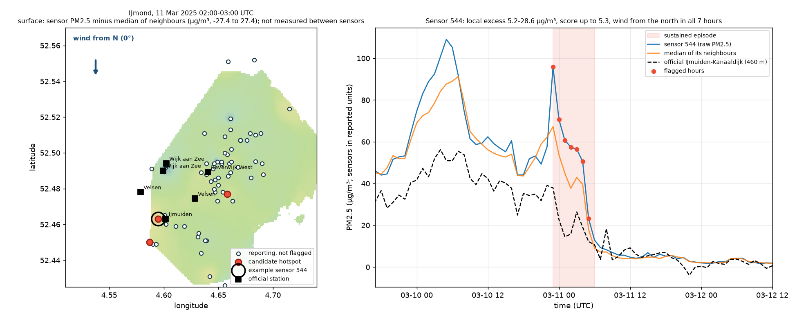

# Screening local PM2.5 hotspots with Hollandse Luchten sensors (Challenge 2)

Citizen sensors measure PM2.5 all over North Holland, but a single reading says little: when the whole region is
polluted, every sensor reads high. Our tool therefore asks a different question for every sensor and every hour:

> **Is this sensor reading clearly more than the sensors around it, at the same time?**

Where the answer is yes, the sensor-hour is a *candidate local hotspot*. The tool then adds context that helps to judge
the candidate: how long it lasts, whether it keeps coming back, which way the wind blew, and whether the sensors
upwind were lower. It is an exploratory **screening tool**: it points at places and hours worth a closer look. It does
not prove where pollution comes from.

**Who it is for:** residents, measurement groups and municipalities who want to know where local PM2.5 is higher than
in the surroundings, and when. **Why it matters for Hollandse Luchten:** a dense citizen network can show local
differences that the few official stations cannot.

## Where to find what the jury asks for

The hackathon asks for five deliverables ([docs/hackathon_README.md](docs/hackathon_README.md#deliverables)). Here is where each one is:

| Deliverable | Where |
|---|---|
| 1. Code, and a README that explains how to run it from scratch | [Run it from scratch](#run-it-from-scratch) (this file). Code: [notebooks/04_hotspot_screening_app.ipynb](notebooks/04_hotspot_screening_app.ipynb) and [scripts/](scripts/) |
| 2. Presentation (5 minutes) | Given live by the team |
| 3. A concrete real-life example (Challenge 2: hotspot on a map, score, wind direction, explanation) | [Worked example](#worked-example-ijmuiden-1011-march-2025) |
| 4. Methodological choices | [Method](#method) and the two documents in [docs/methodology/](docs/methodology/) |
| 5. Validation, limitations | [Validation and known issues](#validation-and-known-issues) |
| AI-use disclosure (required) | [Use of AI tools](#use-of-ai-tools) |

## Run it from scratch

You need Python 3.11 or newer (uv installs it for you if it is missing), about 2 GB of free disk space, and an internet
connection (for the packages, the data download, and the map tiles in the app). It runs on Windows, macOS and Linux.
Nothing is uploaded anywhere; the app runs only on your own computer.

**1. Get the code**

```bash
git clone https://github.com/selahi55/Hackathon-Challenge-2-.git
cd Hackathon-Challenge-2-
```

**2. Install [uv](https://docs.astral.sh/uv/getting-started/installation/)**, the tool that sets up the Python environment.

```bash
# Windows (PowerShell)
powershell -ExecutionPolicy ByPass -c "irm https://astral.sh/uv/install.ps1 | iex"
# macOS / Linux
curl -LsSf https://astral.sh/uv/install.sh | sh
```

**3. Download the sensor data** (84 MB, from [Zenodo](https://zenodo.org/records/23762846); too large for git) into `data/`.
The weather, reference-station and resident files are already in the repository.

```bash
# Windows (PowerShell): use curl.exe, because "curl" is an alias there
curl.exe -L -o data/data_sensors.parquet "https://zenodo.org/records/23762846/files/data_sensors.parquet?download=1"
curl.exe -L -o data/metadata_sensors.parquet "https://zenodo.org/records/23762846/files/metadata_sensors.parquet?download=1"
# macOS / Linux
curl -L -o data/data_sensors.parquet "https://zenodo.org/records/23762846/files/data_sensors.parquet?download=1"
curl -L -o data/metadata_sensors.parquet "https://zenodo.org/records/23762846/files/metadata_sensors.parquet?download=1"
```

**4. Install the packages** (a few minutes the first time; creates `.venv/` from the pinned `uv.lock`)

```bash
uv sync
```

**5. Open the hotspot notebook**

```bash
uv run jupyter lab notebooks/04_hotspot_screening_app.ipynb
```

(In VS Code, open the notebook and choose the `.venv` kernel instead.) **Run the first cell only.** It writes the app to
`output/pm25_hotspot_app.py`, starts it on your computer, and opens it in your browser at
<http://127.0.0.1:8501> (another port if that one is busy; the cell prints the address). Do not run the second cell: it
installs packages with pip, which is not needed here because `uv sync` already did that.

**6. Run an analysis in the app.** The file paths in the sidebar are already correct. Press **Run analysis**. With the
default settings it analyses the first 14 days in the data (January 2020) and takes 10 to 20 seconds. To see the worked
example below, first set *Start timestamp* to `2025-03-01` and *End timestamp, exclusive* to `2025-03-15`.

To stop the app, run `streamlit_process.terminate()` in a notebook cell, or close the Jupyter session.

| Problem | Fix |
|---|---|
| "Missing packages in THIS notebook's Python environment" | The notebook is not using the `.venv` kernel. Start it with `uv run jupyter lab ...` as above, or pick the `.venv` kernel. |
| "Could not find data/data_sensors.parquet" | Do step 3 and run the notebook from inside the repository folder. |
| Memory error during *Run analysis* | Use a shorter window (the analysis keeps only the selected window in memory) and close other programs. |
| The map shows no background | The map tiles need internet. The analysis itself works without them. |

## Using the app

The sidebar holds the settings; **Run analysis** reads the sensor and weather files and scores every sensor-hour. After
that, moving around the map or changing the hour does not rerun the analysis. The tabs:

| Tab | What it shows |
|---|---|
| **Regional map** | Click the Netherlands map or pick a sensor to choose a region. Choose what the colour surface shows (local excess, hourly PM2.5, or spatial slope), set the radius, and move the hour slider. Red dots are candidate hotspots, white dots are other reporting sensors. Click a dot for its reading, local excess, score and status. Below the map: a per-sensor summary and the list of candidate hotspots for the hour. |
| **Episodes** | Runs of consecutive flagged hours per sensor, with duration, mean and peak excess and the wind comparison. |
| **Sensor explorer** | One sensor's hourly PM2.5 against the median of its neighbours, with the flagged hours marked, plus all hourly features. |
| **Wind direction** | For each of eight wind-from sectors: how many assessed sensor-hours there were and what share was flagged. |
| **Method & diagnostics** | The rules in short, the settings of the run, and the processing log. |

The sensor summary, the episodes, the wind sectors and a selected sensor's hours can be downloaded as CSV. When *Save CSV
results* is on, the main result files are also written to `output/pm25_hotspot_results/` (ignored by git).

Important when reading the map: the coloured surface is **interpolated** between sensors and is drawn only where at
least three sensors are close by; blank means "not enough sensors", not "clean air". A sensor-hour with fewer than three
reporting neighbours is *not assessable*, which does not mean it is clean.

## Worked example: IJmuiden, 10–11 March 2025



*The figure and every number below come from [scripts/example_and_validation.py](scripts/example_and_validation.py), which
runs the notebook's own analysis code with its default settings on 1–15 March 2025 (`uv run python scripts/example_and_validation.py`).*

**What the tool found.** In that fortnight 66 sensors in IJmond (Beverwijk, Heemskerk, Velsen, IJmuiden, Wijk aan Zee)
produced 21,319 sensor-hours. All could be assessed, and 439 (2.1 %) were flagged. The 439 form 251 episodes, of which 40
last three hours or more ("sustained"). Two sensors meet the rule for a *recurring* hotspot. We picked the longest
sustained episode in which every hour had a wind direction and an upwind comparison, and whose peak reading was below
100 µg/m³ (so that it is not an obviously faulty sensor):

| | |
|---|---|
| Sensor | `HLL_hl_device_544`, IJmuiden (52.4630 N, 4.5950 E) |
| When | 10 March 23:00 to 11 March 06:00 UTC, 7 consecutive hours ("sustained" episode) |
| Reading | 23–96 reported units, which is **5 to 29 above the median of its neighbours** (mean +15.8); about 29 neighbours within 5 km reported |
| Score | robust score 2.6 to 5.3 (flag threshold: excess at least 5 **and** score at least 2.5) |
| Wind | from the **north** (0–20°) in every hour, KNMI station 2.7 km away |
| Upwind check | the sensors lying north (upwind) of it read 8 to 27 lower, in all 7 hours (`wind_support` = true) |
| Elsewhere in the fortnight | this sensor was flagged in 33 of its 336 hours (north 8, south 12, south-west 8, other 5) |

**Explanation as we would give it to a resident.** *"On the night of 10 to 11 March, the sensor in IJmuiden measured
clearly more fine dust than the sensors around it, for seven hours in a row. The wind came from the north the whole
time, and the sensors north of it measured less. That fits a local source to the north of this sensor. But it is a
lead, not proof: the nearest official station, 460 m away, did not read higher than the other stations (it was at or
below their median in 5 of the 7 hours), and the sensor measures in uncalibrated units. The next step would be to look
at this sensor's calibration and at activity in the area to the north."*

The right panel of the figure shows why comparing with neighbours matters: on 10 March the *whole* region had high
values (60 to 110 units), and the sensor followed its neighbours closely. Only the hump at the end of the evening
stands out from them. With a fixed concentration limit the whole day would have been flagged.

**To see it in the app:** set the window as in step 6, press *Run analysis*, open **Regional map**, choose *Sensor
location* and `HLL_hl_device_544`, select the hour 2025-03-11 02:00 UTC and *Local excess above nearby-sensor median*.
The **Episodes** and **Sensor explorer** tabs show the episode and the time series for this sensor.

## Method

The method is a heuristic screening rule, documented in two documents. Please read them for the full definitions:

- [docs/methodology/Methodology (2).pdf](<docs/methodology/Methodology (2).pdf>): *A Heuristic Approach to Screening Local
  PM2.5 Hotspots*: objective, formulas, worked examples, limitations.
- [docs/methodology/Methodology_code.pdf](docs/methodology/Methodology_code.pdf): *PM2.5 Hotspot Explorer: Code and
  Methodology Documentation*: how the notebook cell and the app implement it.

**In short**, for every sensor *i* and hour *t* (readings are the hourly mean of `pm25_raw`, in the reported units):

1. **Neighbours.** The (at most) 30 nearest other sensors within 5 km (haversine distance). Only neighbours that report
   in that hour count; more distant sensors are not substituted.
2. **Local background and excess.** If at least 3 neighbours report: background B = median of their readings; local
   excess E = reading − B. The median is used because one extreme neighbour does not move it.
3. **Robust score.** Z = E / max(1.4826 × MAD, 2), where MAD is the median absolute deviation of the neighbours around B.
   The floor of 2 stops a tiny spread among neighbours from giving an enormous score.
4. **Flag.** A sensor-hour is a *candidate hotspot* when E ≥ 5 **and** Z ≥ 2.5. There is no absolute concentration
   threshold. With fewer than 3 reporting neighbours the hour is *not assessable*.
5. **Context (not part of the flag).**
   - *Spatial slope*: a distance-weighted plane through the neighbours (east and north change per km); needs at least 4
     neighbours and a well-conditioned fit.
   - *Temporal slope*: trend over the last 3 hours of the reading and of the excess.
   - *Wind*: wind-from direction (KNMI `DD`) of the nearest station within 25 km; `DD` 0 is calm, 990 variable; times shifted
     back one hour because KNMI labels the end of the hour. *Upwind check*: with at least 2 neighbours within 45° of the
     upwind direction, is the sensor at least 5 above their median?
6. **Episodes and recurrence.** An episode is a run of consecutive flagged hours; 3 hours or more is *sustained*. A
   sensor is a *recurring* hotspot candidate when it has at least 24 assessable hours, covering at least 50 % of the
   window, flagged in at least 20 % of them, on at least 3 different days.
7. **Map surface.** Inverse-distance weighting from up to 12 sensors, drawn only where at least 3 sensors lie within the
   support radius and inside the area the sensors span. The colour scale is fixed per run at the 98th percentile.

All numbers are the defaults and can be changed in the sidebar.

**Why this design.** The aim is to find local differences that residents can understand and check, not to model
emissions.
- *Relative, not absolute.* Weather moves the whole region at once, so a fixed limit would flag everything on a bad day. Comparing with
  neighbours in the same hour removes that shared signal.
- *Median and MAD.* Robust to the faulty or extreme neighbour that cheap sensors sometimes produce.
- *Transparent thresholds.* Every threshold is visible and adjustable, and every flag can be traced to its numbers.
- *Wind as context.* A physical dispersion model needs emissions, mixing and terrain that we do not have. Wind only
  helps to judge whether a candidate fits a source on the upwind side.
- *No claim of causes.* The score is a descriptive screening value, not a probability or significance test.

**A second prototype** by a team member compares compass directions for a source with wind and PM spikes per
sensor cluster ([challenge 2/documentation](<challenge 2/documentation>), code in [challenge 2/test_eashan](<challenge 2/test_eashan>)).
It is not part of the submission described here, and its code is a notebook cell with local paths that we have not made
runnable from this repository.

## Validation and known issues

We want to be clear about what has and has not been checked.

**What was checked**

- *Method on synthetic data.* The methodology document states that the implementation was tested on synthetic data for
  aggregation, missing-hour handling, wind special codes and episode classification, and that it has **not** been
  validated against independently verified hotspots.
- *Comparison with the official reference stations* (`scripts/example_and_validation.py`, IJmond, 1–15 March 2025). We
  took the 22 sensor–station pairs where a sensor lies within 1 km of one of the six Luchtmeetnet stations, and
  compared the sensor's local excess with the station's excess (station minus the median of the stations) in the same
  hours. Agreement is **weak but positive**: median rank correlation 0.13 (range −0.30 to 0.27, positive in 15 of 22
  pairs). In a sensor's flagged hours the nearby official station read on average 4.6 µg/m³ above the other stations,
  versus 0.9 µg/m³ in its other hours (15 pairs with at least 3 flagged hours). So flags tend to coincide with somewhat
  higher official readings, but weakly, and the worked-example sensor is a case where the nearest station did not
  confirm it. This is one fortnight, one region and six stations; it is not proof of skill.
- *Resident judgements of an earlier flagging algorithm* (`data/labeled_data/`, 205 judgements about 5 sensors; a
  different algorithm, so only indicative): every flag that residents called unjustified had a value of at most
  30.6 µg/m³, and they often explained that nearby sensors showed the same pattern. This supports comparing with
  neighbours, and warns that flags at low concentrations are often false alarms, which matters for our minimum excess of
  5 units.

**Known issues** (important for interpretation)

1. **Faulty sensors are flagged.** There is no cleaning step, and a sensor far above its neighbours is exactly what the
   rule detects. In the app's default window (first 14 days of January 2020) the most-flagged sensors include
   `HLL_hl_device_218`, a Nova SDS011 that reports exactly 344.5 µg/m³ in all of its 333 hours (a stuck sensor) and is
   flagged in 332 of them. Check the sensor in the *Sensor explorer* before reading a flag as a hotspot.
2. **Raw, uncalibrated PM2.5.** The method uses `pm25_raw`, as documented in the methodology; the calibrated column
   `pm25_kal` is not used. Raw readings can be far above the official stations (in the worked example the sensor read
   roughly twice the nearest official station at the peak on 10 March), so absolute values must not be compared with
   air-quality limits.
3. **Missing wind in IJmond.** The app gives every sensor the nearest KNMI station, also when that station reports no
   wind. For IJmond this is Wijk aan Zee, which has no wind data: in the example fortnight 53 of the 66 IJmond sensors
   use it, so 80 % of their sensor-hours (16,977 of 21,319) have no wind direction and no upwind check. The worked
   example is one of the sensors that use the station at IJmuiden. Wind speed is not used, and the wind at a KNMI
   station may differ from the wind at the sensor.
4. **Stationary sensors are assumed.** Each sensor gets the average of its reported coordinates in the window, so a
   sensor that moved is drawn at a place it may never have been, and several sensors stacked on one spot (for example
   a hand-out spot) count as neighbours of each other.
5. **Window dependence.** Episodes and recurrence describe the chosen window only. The default window is the first 14
   days of the file (January 2020), not recent data; set a start and end for other periods.
6. **No uncertainty estimates.** Scores and slopes have no confidence intervals; thresholds are exploratory. Different
   radii or thresholds change what is flagged, and we recommend checking that.
7. **Broad events can be missed** when all neighbours rise together, and sparse neighbourhoods make comparisons unstable.

## The sensor viewer

[PMsensorViewNoiseSuppression/](PMsensorViewNoiseSuppression/) holds `PMsensorViewer.exe`, a Windows desktop viewer that
shows the sensor locations and the team's initial approach (its folder is named `PMsensorViewNoiseSuppression`). It is
separate from the notebook app. From the program's own messages, it reads `PMdata/data_sensors.xlsx` (the sensor table
converted to Excel; it needs six sensor columns, including `pm25_raw`, `pm25_kal`, `latitude` and `longitude`), keeps
complete one-hour PM2.5 records inside the Amsterdam region map for 2020 to 2025, and reports how many rows it
dropped.

- The Excel file is 444 MB and cannot be stored on GitHub. **Download link: [team to insert before submission].**
  Save it as `PMsensorViewNoiseSuppression/PMdata/data_sensors.xlsx` (that folder is ignored by git).
- The executable is not code-signed. Its SHA-256 is
  `955A72B4524C098420C7305114F442FA251ADD7E73A61F04C8C582061BFBAFD4`; check it with
  `Get-FileHash PMsensorViewNoiseSuppression/PMsensorViewer.exe` (PowerShell) if you want to be sure it is the file we
  submitted. The hotspot app above does not need the viewer.

## What is in this repository

```
README.md                  this file
notebooks/
  04_hotspot_screening_app.ipynb          the submitted method: writes and starts the Streamlit hotspot app
  01_sensor_data_overview.ipynb           first look at the sensor file (sample-based): size, missing values, PM2.5 distribution
  02_pm25_outliers_and_missing_humidity.ipynb   PM2.5 outlier review (box plot, IQR fences) and where humidity is missing
  03_knmi_weather_overview.ipynb          KNMI weather file: stations, coverage and wind directions
scripts/
  example_and_validation.py               reproduces the worked example, its figure and the validation numbers
docs/
  methodology/                            the two methodology documents (PDF)
  example/                                the figure of the worked example
  hackathon_README.md, data.md, tips.md, resources.md, ...   the organizers' documents
challenge 2/               the challenge text, and an earlier source-direction prototype (documentation + code)
data/                      knmi_weather_data.parquet, reference measurements and stations, resident questions,
                           labeled_data/; data_sensors.parquet and metadata_sensors.parquet come from Zenodo (step 3)
PMsensorViewNoiseSuppression/   the sensor viewer (see above)
pyproject.toml, uv.lock    the Python environment (uv)
output/                    created when you run the app: the generated app, logs and CSV results (ignored by git)
```

The three exploration notebooks (01 to 03) keep their saved results, so you can read them without running them. To run
them, start them from the `notebooks/` folder with `uv run jupyter lab notebooks/`.

## Use of AI tools

The hackathon asks teams to say where AI tools were and were not used. AI assistants **were** used in this project:

- **Claude Code (Anthropic)** was used in this repository to organise the repository, explore the data, make the
  notebooks run from the repository (relative paths, the uv environment), write this README and
  `scripts/example_and_validation.py`, and to run checks on the work (for example the validation runs above).
- **Team members also used AI assistants** to help develop parts of the screening method, the notebook app and the
  two methodology documents. (Which assistants: the team will name them in the presentation.)
- **Not done by AI:** the data are real, unmodified Hollandse Luchten, KNMI and Luchtmeetnet files; every number in the
  worked example and the validation comes from running the code on them, not from a model's text.

## Data and licences

Hollandse Luchten sensor data (Zenodo record 23762846), KNMI hourly observations and Luchtmeetnet reference data are
open data; see [docs/data.md](docs/data.md) for the description of every table and the conventions we follow (UTC for
sensors, KNMI timestamps mark the end of the hour). Map tiles in the app: © OpenStreetMap contributors. The original
challenge description is in [docs/hackathon_README.md](docs/hackathon_README.md).
